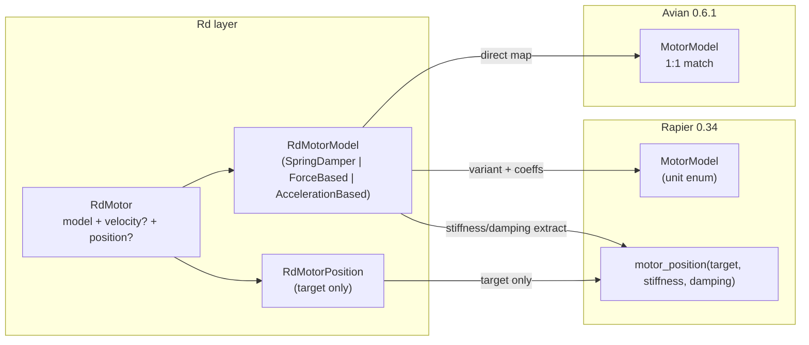

# Align RdMotorModel with Avian MotorModel

## Recommendation

**Yes — this is the right direction.** The current split is awkward: stiffness/damping live on `RdMotorPosition` even when joints run in velocity mode (see [multi_joints_controller_avian3d.rs](crates/robocomp_avian3d/examples/multi_joints_controller_avian3d.rs) lines 128–131, where `position` is `Some` solely to pass `damping: 0.1` into the motor model). Avian 0.6.1 puts all model parameters on `MotorModel` itself; robocomp should mirror that enum shape at the `Rd` layer.

**Default choice:** use `AccelerationBased` as `RdMotorModel::default()`, not `SpringDamper`. Rapier defaults to `AccelerationBased` and has no `SpringDamper` variant, so this is the only default that maps 1:1 to both backends without approximation. `SpringDamper` remains available for Avian-specific tuning when desired.

**Rapier is also straightforward for the two existing variants**, but Rapier has no `SpringDamper` — only a unit enum (`AccelerationBased` / `ForceBased`) with stiffness/damping passed separately to `motor_position`. That API difference stays; we just source stiffness/damping from `RdMotorModel` instead of `RdMotorPosition`.



## Proposed type changes

In [`src/rd/mod.rs`](src/rd/mod.rs):

```rust
#[derive(Debug, Clone, Reflect)]
pub enum RdMotorModel {
    SpringDamper { frequency: f32, damping_ratio: f32 },
    ForceBased { stiffness: f32, damping: f32 },
    AccelerationBased { stiffness: f32, damping: f32 },
}

impl Default for RdMotorModel {
    fn default() -> Self {
        // Cross-backend default: Rapier's default model + existing robocomp velocity-motor fallback coeffs
        Self::AccelerationBased { stiffness: 0.0, damping: 1.0 }
    }
}

#[derive(Debug, Clone, Reflect)]
pub struct RdMotorPosition {
    pub target: RdScaler,
    // stiffness / damping removed
}
```

`RdMotor`, `RcRevoluteJointMotor`, `RcPrismaticJointMotor`, and `RcSphericalJointMotor` keep the same shape; only the nested types change. **`RcJointMotorControlConfig` is unchanged** — it is runtime controller tuning, not declarative joint data.

## Backend conversion changes

### Avian ([`crates/robocomp_avian3d/src/conversions.rs`](crates/robocomp_avian3d/src/conversions.rs))

Becomes a near 1:1 map — delete the `stiffness`/`damping` extra args on `motor_model_from_rd`:

```rust
pub fn motor_model_from_rd(value: RdMotorModel) -> MotorModel {
    match value {
        RdMotorModel::SpringDamper { frequency, damping_ratio } =>
            MotorModel::SpringDamper { frequency, damping_ratio },
        RdMotorModel::ForceBased { stiffness, damping } =>
            MotorModel::ForceBased { stiffness, damping },
        RdMotorModel::AccelerationBased { stiffness, damping } =>
            MotorModel::AccelerationBased { stiffness, damping },
    }
}
```

`angular_motor_from_rd` / `linear_motor_from_rd` simplify to `MotorModel::new(motor_model_from_rd(motor.model.clone()))` without reading position for coefficients.

### Rapier ([`crates/robocomp_rapier3d/src/conversions.rs`](crates/robocomp_rapier3d/src/conversions.rs) + [`pre_processor_plugin.rs`](crates/robocomp_rapier3d/src/pre_processor_plugin.rs))

Add a small helper (in `conversions.rs`):

- `rapier_motor_model_from_rd(RdMotorModel) -> MotorModel` — maps `AccelerationBased`/`ForceBased` directly; **`SpringDamper` maps to `MotorModel::AccelerationBased`** (Rapier has no equivalent).
- `stiffness_damping_from_rd(RdMotorModel) -> (f32, f32)` — returns fields for `AccelerationBased`/`ForceBased`; for `SpringDamper`, approximate acceleration-based coefficients:

  `ω = 2π·frequency`, `stiffness = ω²`, `damping = 2·damping_ratio·ω`

  This is the standard unit-mass second-order-system conversion. Document in a one-line comment that Rapier behavior will differ from Avian's implicit spring-damper integrator.

Update all `motor_position(...)` call sites to use `position.target` + `stiffness_damping_from_rd(model)` instead of `position.stiffness`/`position.damping`.

**Optional small improvement (low risk):** when `position` is `None` but a motor is configured, still pass `(target=0, stiffness, damping)` from the model so velocity-only motors get damping on Rapier (today they get Rapier's zero-stiffness default). Not required for the refactor but fixes an existing asymmetry with Avian.

## Example / default updates

| Location | Change |
|---|---|
| [multi_joints_controller_avian3d.rs](crates/robocomp_avian3d/examples/multi_joints_controller_avian3d.rs) | Move `stiffness`/`damping` into `model:`; `RdMotorPosition { target: 0. }` only |
| [multi_joints_controller_rapier3d.rs](crates/robocomp_rapier3d/examples/multi_joints_controller_rapier3d.rs) | `RdMotorModel::AccelerationBased { stiffness: 0., damping: 0.1 }` for position-controlled joints |
| Other examples using `RdMotorModel::AccelerationBased` | Add `{ stiffness, damping }` fields |
| [avian pre_processor default_motor](crates/robocomp_avian3d/src/pre_processor_plugin.rs) | `RdMotorModel::default()` (no longer bare `AccelerationBased` unit variant) |

## Default rationale

| Backend | Native default | Maps from `RdMotorModel::default()`? |
|---|---|---|
| Rapier | `MotorModel::AccelerationBased` | Yes — direct |
| Avian | `MotorModel::SpringDamper { 5.0, 1.0 }` | No — but `AccelerationBased { 0.0, 1.0 }` is a sensible velocity-motor baseline and matches robocomp's existing `(0, 1)` fallback in avian conversions |

`SpringDamper` is opt-in for Avian users who want Avian's unconditionally-stable integrator. On Rapier it is always approximated to `AccelerationBased` coefficients.

## Breaking changes

- **Serde/Reflect scenes** using old unit-variant `RdMotorModel` or `RdMotorPosition { stiffness, damping }` will need migration.
- **Default changes**: `ForceBased` (unit) → `AccelerationBased { stiffness: 0.0, damping: 1.0 }`. Closer to Rapier semantics; Avian behavior for `default()` callers shifts from force-based to acceleration-based damping.

## Files to touch

1. [`src/rd/mod.rs`](src/rd/mod.rs) — core types + `Default`
2. [`src/type_registry_plugin.rs`](src/type_registry_plugin.rs) — no structural change needed (enum still registered)
3. [`crates/robocomp_avian3d/src/conversions.rs`](crates/robocomp_avian3d/src/conversions.rs)
4. [`crates/robocomp_rapier3d/src/conversions.rs`](crates/robocomp_rapier3d/src/conversions.rs)
5. [`crates/robocomp_rapier3d/src/pre_processor_plugin.rs`](crates/robocomp_rapier3d/src/pre_processor_plugin.rs) — spherical motor paths too
6. All 6 motor examples (avian + rapier)
7. [`crates/robocomp_avian3d/src/pre_processor_plugin.rs`](crates/robocomp_avian3d/src/pre_processor_plugin.rs) — default motor

**Not in scope:** `RcJointMotorControlConfig` and controller plugins already set `MotorModel` at runtime from controller config; they don't need changes for this refactor.

## Verification

```bash
cargo check --workspace
cargo run -p robocomp_avian3d --example multi_joints_controller_avian3d
cargo run -p robocomp_rapier3d --example multi_joints_controller_rapier3d
```

Confirm velocity-mode joints still get correct damping from `model`, and position-mode joints still track with expected stiffness.
