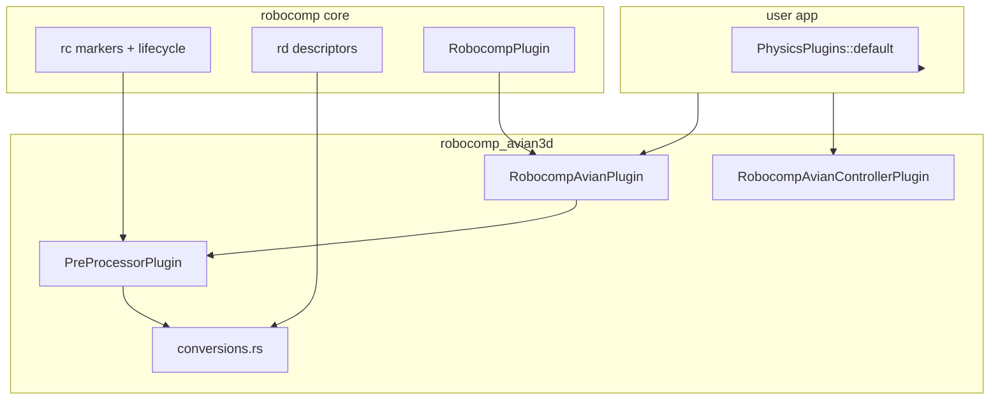

# robocomp_avian3d Integration Plan

## Goal

Create [`crates/robocomp_avian3d`](crates/robocomp_avian3d) as a parallel physics backend to [`crates/robocomp_rapier3d`](crates/robocomp_rapier3d), using [Avian v0.6.1](https://github.com/avianphysics/avian/tree/v0.6.1) (`avian3d` crate, Bevy 0.18). Consumers should get the same `rc`/`rd` authoring model, the same 6 examples, and the same integration tests via [`robocomp_test_utils`](crates/robocomp_test_utils).

## API version discipline (v0.6.1 only)

All API references during implementation must be pinned to the **`v0.6.1` tag**, not `main` or `v0.7.x`. Earlier plan drafts mixed in `main`-branch examples and incorrect names (e.g. `ColliderDebugPlugin`).

**Verified against `avianphysics/avian` tag `v0.6.1`:**

| Area | Correct v0.6.1 API |
|------|-------------------|
| Physics plugin group | `PhysicsPlugins::default()` |
| Debug rendering | `PhysicsDebugPlugin` (not `ColliderDebugPlugin`; must be added manually) |
| Schedule / ordering | `PhysicsSystems::{Prepare, StepSimulation, ...}` in `FixedPostUpdate` (default) |
| Joint anchors | `with_local_anchor1/2(Vector)` — mirrors Rapier's `.local_anchor1/2(...)` on joint builders; same preprocessor anchor math can be reused |
| Revolute axis | `with_hinge_axis(Vector)` (not deprecated `with_aligned_axis`) |
| Prismatic axis | `with_slider_axis(Vector)` |
| Revolute limits | `with_angle_limits(min, max)` |
| Prismatic limits | `with_limits(min, max)` |
| Spherical limits | `with_swing_limits` / `with_twist_limits` (not per-axis `ang_x/y/z` like Rapier) |
| Motors | `AngularMotor::new(model).with_target_velocity(...)` / `LinearMotor::new(model).with_target_position(...)`; fields on `joint.motor` are mutated at runtime |
| Motor models | `MotorModel::AccelerationBased { stiffness, damping }`, `ForceBased { ... }`, or `SpringDamper { frequency, damping_ratio }` (default in Avian) |
| Sleep disable | `SleepingDisabled` component |
| Collider from mesh | `Collider::trimesh_from_mesh`, `convex_hull_from_mesh`, `convex_decomposition_from_mesh` (behind default `collider-from-mesh` feature) |
| Collider density | `ColliderDensity(f32)` component on collider entity |
| Joint spawn | Separate entity: `commands.spawn(RevoluteJoint::new(body1, body2)...)` |

Official v0.6.1 examples to follow: [`revolute_joint_3d.rs`](https://github.com/avianphysics/avian/blob/v0.6.1/crates/avian3d/examples/revolute_joint_3d.rs), [`joint_motors_3d.rs`](https://github.com/avianphysics/avian/blob/v0.6.1/crates/avian3d/examples/joint_motors_3d.rs), [`trimesh_shapes_3d.rs`](https://github.com/avianphysics/avian/blob/v0.6.1/crates/avian3d/examples/trimesh_shapes_3d.rs).

## Architecture (mirror rapier3d)



**Plugin contract (same as Rapier):**
- `RobocompAvianPlugin` bundles `RobocompPlugin` + `PreProcessorPlugin` only.
- User must separately add `PhysicsPlugins::default()` (and optionally Avian debug rendering).
- `lib.rs` re-exports full core: `pub use robocomp::*`, `rc`, `rd`.

## Workspace changes

Update [`Cargo.toml`](Cargo.toml):

```toml
[workspace]
members = [".", "crates/robocomp_rapier3d", "crates/robocomp_avian3d", "crates/robocomp_test_utils"]
default-members = ["."]   # per your preference

[workspace.dependencies]
avian3d = "0.6.1"
```

`collider-from-mesh`, `debug-plugin`, and `bevy_scene` are all **default** features on `avian3d` 0.6.1 — no need to list them explicitly unless we later use `default-features = false` (e.g. for `f64` builds). A plain version pin is sufficient.

New [`crates/robocomp_avian3d/Cargo.toml`](crates/robocomp_avian3d/Cargo.toml) mirrors rapier3d deps, swapping `bevy_rapier3d` for `avian3d` (workspace dep, defaults on).

## Crate file layout

```
crates/robocomp_avian3d/
├── Cargo.toml
├── src/
│   ├── lib.rs
│   ├── avian_plugin.rs          # RobocompAvianPlugin
│   ├── pre_processor_plugin.rs  # 8-system chained pipeline
│   ├── conversions.rs           # Rc/Rd → Avian types
│   └── controller_plugin.rs     # joint keyboard control + debug gizmos
├── examples/                    # 6 examples + helpers (copy from rapier3d)
│   └── helpers/{scene_setup,workspace_assets}.rs
└── tests/
    ├── avian_backend.rs         # PhysicsTestBackend impl
    ├── sample.rs
    └── multi_robots.rs
```

## Module-by-module implementation

### 1. `avian_plugin.rs`

Direct mirror of [`rapier_plugin.rs`](crates/robocomp_rapier3d/src/rapier_plugin.rs):

```rust
app.add_plugins((RobocompPlugin, PreProcessorPlugin));
```

### 2. `conversions.rs`

Mirror public API from [`conversions.rs`](crates/robocomp_rapier3d/src/conversions.rs). Joint attachment uses **`with_local_anchor1/2`** to stay parallel with Rapier's `.local_anchor1/2(...)` — the preprocessor already computes the same `local_anchor_1` / `local_anchor_2` `Vec3` values from `RcJointLocalAnchor1/2`:

```rust
use avian3d::math::Vector;

// Revolute example (parallel to Rapier RevoluteJointBuilder):
RevoluteJoint::new(parent, child)
    .with_local_anchor1(Vector::from(local_anchor_1))
    .with_local_anchor2(Vector::from(local_anchor_2))
    .with_hinge_axis(Vector::from(axis))
    .with_angle_limits(limits.min, limits.max)
    .with_motor(angular_motor_from_rd(motor))
```

| Function | Avian v0.6.1 mapping |
|----------|----------------------|
| `rigid_body_from_rc` | `RcRigidBody::Fixed` → `RigidBody::Static`; `Dynamic` → `RigidBody::Dynamic` |
| `fixed_joint_from_rd` | `FixedJoint::new(body1, body2).with_local_anchor1/2(...)` |
| `revolute_joint_from_rd` | `RevoluteJoint::new(...).with_hinge_axis(axis).with_local_anchor1/2(...).with_angle_limits(...).with_motor(AngularMotor::...)` |
| `prismatic_joint_from_rd` | `PrismaticJoint::new(...).with_slider_axis(axis).with_local_anchor1/2(...).with_limits(...).with_motor(LinearMotor::...)` |
| `spherical_joint_from_rd` | `SphericalJoint::new(...).with_local_anchor1/2(...)`; map `RcSphericalJointLimits` to `with_swing_limits` / `with_twist_limits` where possible (no 1:1 ang_x/y/z mapping) |
| `motor_model_from_rd` | `RdMotorModel::AccelerationBased` → `MotorModel::AccelerationBased { stiffness, damping }`; `ForceBased` → `MotorModel::ForceBased { ... }`; use `RdMotorPosition` stiffness/damping when building position motors |
| `angular_motor_from_rd` | `AngularMotor::new(motor_model_from_rd(...)).with_target_velocity(...).with_target_position(...).with_max_torque(...)` |
| `linear_motor_from_rd` | Same pattern with `LinearMotor` |

`with_local_frame1/2` remain available in 0.6.1 if basis alignment is needed later, but are not used for the initial integration.

### 3. `pre_processor_plugin.rs`

Copy the 8-system chain from [`pre_processor_plugin.rs`](crates/robocomp_rapier3d/src/pre_processor_plugin.rs) and adapt only the physics-specific inserts:

**Unchanged (physics-agnostic) — candidate for future core extraction:**
- `process_group_markers`, `process_scene_root_markers`, `process_root_markers`
- `check_processing_complete`, `detach_root_markers_and_flatten_hierarchy`
- Anchor resolution math (global → local anchors from `RcJointLocalAnchor1/2`)

**Backend-specific adaptations:**

| Step | Rapier today | Avian plan |
|------|--------------|------------|
| Links | `RigidBody`, `Velocity::zero()`, `Ccd`, `Sleeping::disabled()` | `RigidBody`, `SleepingDisabled` for `RcDisableSleep`; no CCD equivalent needed initially |
| Colliders | `Collider::from_bevy_mesh(mesh, shape)` + `ColliderMassProperties::Density` | `Collider::trimesh_from_mesh` / `convex_hull_from_mesh` / `convex_decomposition_from_mesh` (per `RcColliderConstruction`) + `ColliderDensity(density)` on collider entity |
| Joints | `ImpulseJoint` / `MultibodyJoint` inserted **on child link** | Spawn **separate joint entity** (Avian idiom): `commands.spawn(RevoluteJoint::new(parent, child)...)` |
| Graph | `joint_entity = child_link` | `joint_entity = joint_entity` (the spawned joint) |
| Motor config | `RcJointMotorControlConfig` on child link | `RcJointMotorControlConfig` on joint entity |
| Multibody | `MultibodyJoint` for `RcJointCategory::Multibody` | Treat same as Impulse — spawn standard XPBD joint; no Rapier-style multibody articulation |

**Joint spawn pattern (key difference from Rapier):**

```rust
// Rapier: commands.entity(child_link).insert(ImpulseJoint::new(parent, joint));
// Avian (v0.6.1) — same anchor values, separate joint entity:
let joint_ent = commands.spawn(
    revolute_joint_from_rd(...)
        .with_local_anchor1(local_anchor_1)
        .with_local_anchor2(local_anchor_2)
        .with_hinge_axis(axis),
).id();
robot_graph.add_joint(RcRobotGraphJoint { joint_entity: joint_ent, ... });
```

### 4. `controller_plugin.rs`

Mirror [`controller_plugin.rs`](crates/robocomp_rapier3d/src/controller_plugin.rs) with these changes:

| Feature | Avian approach |
|---------|----------------|
| System ordering | `.after(PreProcessorPluginSystemSet).before(PhysicsSystems::Prepare)` in `FixedPostUpdate` (Avian default schedule) |
| Motor control | `Update` or `FixedUpdate` system mutating `joint.motor.target_velocity` / `joint.motor.target_position` on `RevoluteJoint` / `PrismaticJoint` (matches [v0.6.1 `joint_motors_3d`](https://github.com/avianphysics/avian/blob/v0.6.1/crates/avian3d/examples/joint_motors_3d.rs)) |
| Active joint tracker | Reuse same `ActiveJointControlTracker` logic; query joint entity (not `With<RcLink>`) |
| Input mapping | Reuse `get_motor_control_args` logic (copy for now; extract to core later) |
| IK (`apply_ik_target_tracking`) | **Omit** — Avian 0.6 has no Rapier-style multibody IK API |
| Spherical motors | **Stub/TODO** (same gap as Rapier backend) |
| Debug gizmos | Keep `debug_render_active_joint`; highlight active joint's child link via graph lookup |

### 5. Tests

Mirror [`tests/rapier_backend.rs`](crates/robocomp_rapier3d/tests/rapier_backend.rs):

- `AvianBackend` implements `PhysicsTestBackend`
- `RobocompAvianTestHarnessPlugin` adds `PhysicsPlugins::default()` + registers `AvianColliderProxy`
- `validate_colliders`: every `RcCollider` has Avian `Collider`
- `validate_links`: every `RcLink` has Avian `RigidBody` + `Collider` (on self or mesh child)
- [`tests/sample.rs`](crates/robocomp_rapier3d/tests/sample.rs) and [`tests/multi_robots.rs`](crates/robocomp_rapier3d/tests/multi_robots.rs) become one-liners using `AvianBackend`

Run: `cargo test -p robocomp_avian3d`

### 6. Examples (6 total, plugin swap only)

Copy from [`crates/robocomp_rapier3d/examples/`](crates/robocomp_rapier3d/examples/) and replace:

```rust
// Before (Rapier)
use bevy_rapier3d::{plugin::{NoUserData, RapierPhysicsPlugin}, render::RapierDebugRenderPlugin};
use robocomp_rapier3d::{RobocompRapierPlugin, RobocompRapierControllerPlugin, ...};

app.add_plugins((
    RapierPhysicsPlugin::<NoUserData>::default(),
    RapierDebugRenderPlugin::default(),
    RobocompRapierPlugin,
));

// After (Avian)
use avian3d::prelude::*;
use robocomp_avian3d::{RobocompAvianPlugin, RobocompAvianControllerPlugin, ...};

app.add_plugins((
    PhysicsPlugins::default(),
    PhysicsDebugPlugin,  // optional; requires debug-plugin feature (on by default)
    RobocompAvianPlugin,
));
```

| Example | Purpose |
|---------|---------|
| `simple_rigid_bodies` | Fixed table + falling dynamic cube |
| `revolute` | Passive revolute motor spin |
| `prismatic_controller` | W/S/Shift velocity control |
| `multi_joints_controller` | 5-link chain, joint cycling |
| `skein_revolute` | Blender GLTF via Skein |
| `skein_prismatic` | Blender GLTF via Skein |

Duplicate `examples/helpers/` into avian crate (same as rapier today). Sharing helpers via `robocomp_test_utils` is a possible follow-up.

## Known limitations (document in crate README or module docs)

- **No IK backend**: `RcIkTarget` / `RcIkTargetSource` / `RcJointCategory::Multibody` are accepted at authoring time but Avian backend does not run IK.
- **Spherical joint motors**: not supported in Avian 0.6 (only revolute/prismatic motors).
- **Spherical limits**: Avian uses swing/twist limits, not Rapier's per-axis `ang_x/y/z`; best-effort mapping only.
- **Joint entity model differs from Rapier**: `RcRobotGraphJoint.joint_entity` points to the Avian joint entity, not the child link. Controller code must query joint components on that entity.
- **Motor model mapping**: Avian defaults to `MotorModel::SpringDamper`; robocomp's `RdMotorModel` maps to `AccelerationBased` / `ForceBased` using `RdMotorPosition` stiffness/damping when available.

## Follow-up: core extraction candidates

Deferred per your preference. When both backends are stable, extract from the two `pre_processor_plugin.rs` files into core (new `robocomp::integration` module or similar):

1. Marker propagation systems (`process_group/scene/root_markers`)
2. Scene readiness + hierarchy flattening (`check_processing_complete`, `detach_root_markers_and_flatten_hierarchy`)
3. Joint anchor resolution helper (pure math from `GlobalTransform` + anchor children)
4. `ActiveJointControlTracker` component + cycling logic
5. `get_motor_control_args` (input → position/velocity targets)
6. `PreProcessorPluginSystemSet` ordering contract
7. Optional `PhysicsBackend` trait for collider/joint insertion hooks

Keep in backend crates: Avian/Rapier type conversions, collider mesh construction, motor mutation APIs, Rapier-only IK.

## Verification checklist

- `cargo check -p robocomp_avian3d`
- `cargo test -p robocomp_avian3d`
- `cargo run -p robocomp_avian3d --example simple_rigid_bodies`
- `cargo run -p robocomp_avian3d --example prismatic_controller`
- `cargo run -p robocomp_avian3d --example multi_joints_controller`
- Update root [`README.md`](README.md) to list `robocomp_avian3d` alongside `robocomp_rapier3d`

## Risk areas to watch during implementation

1. **Collider density/mass**: Avian uses different mass property components than Rapier's `ColliderMassProperties::Density` — verify visually in `simple_rigid_bodies` that cube mass feels correct.
2. **Collider mesh timing**: Avian collider-from-mesh may need the mesh asset loaded; if `trimesh_from_mesh` fails at preprocess time, defer collider creation to a follow-up system (same pattern as Rapier's mesh availability check).
3. **Joint limits sign/range**: Avian uses `with_angle_limits(min, max)` / `with_limits(min, max)` — confirm Blender-exported limits match axis conventions used in existing examples.
