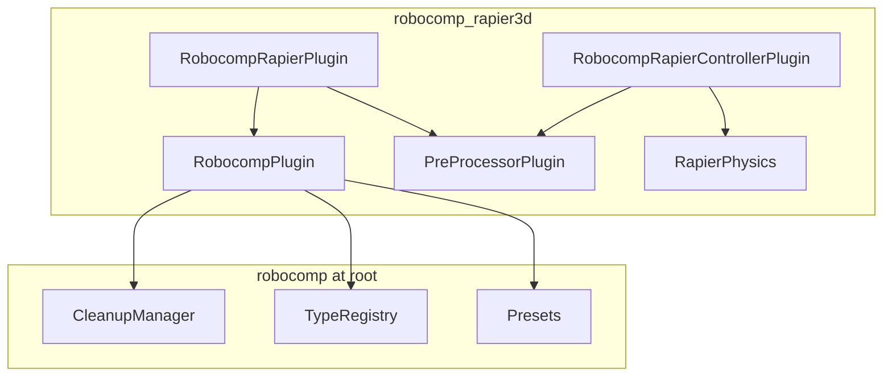
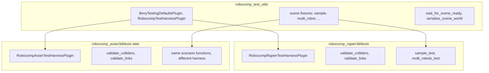

# robocomp / robocomp_rapier3d Workspace Split

## Recommended layout (your preference: core at root)

```
robocomp/                          # workspace root + core crate
├── Cargo.toml                     # [workspace] + [package] name = "robocomp"
├── src/                           # physics-agnostic core (moved/split from today)
├── assets/                        # stays here (workspace-level)
├── blender/
├── crates/
│   ├── robocomp_rapier3d/           # Rapier backend + examples + integration tests
│   │   ├── Cargo.toml
│   │   ├── src/
│   │   ├── examples/
│   │   └── tests/
│   ├── robocomp_test_utils/       # internal, unpublished — shared fixtures
│   └── robocomp_avian3d/            # later, same shape as rapier
└── README.md
```

**Why core at root (your choice) works well here:**

- The repo *is* the core crate — simplest `cargo publish` story for `robocomp`.
- Physics backends are clearly “extensions” under `crates/`.
- `assets/` naturally lives at workspace root; Rapier examples reference it via a relative path (see below).

**Workspace `Cargo.toml` sketch:**

```toml
[workspace]
resolver = "2"
members = [".", "crates/robocomp_rapier3d", "crates/robocomp_test_utils"]
default-members = ["crates/robocomp_rapier3d"]  # most dev work hits Rapier crate

[workspace.dependencies]
bevy = { version = "0.18", ... }
# shared versions for all members
```

---

## What moves where

### Stays in root `[robocomp](Cargo.toml)` (core)


| Module                                                       | Rationale                                                                                            |
| ------------------------------------------------------------ | ---------------------------------------------------------------------------------------------------- |
| `[src/rd/mod.rs](src/rd/mod.rs)`                             | URDF-inspired data types — **minus** `From<Rd*JointData> for` *JointBuilder`and`From for MotorModel` |
| `[src/rc/mod.rs](src/rc/mod.rs)`                             | Editor/scene marker components — **minus** `From<RcRigidBody> for RigidBody`                         |
| `[src/cleanup_manager.rs](src/cleanup_manager.rs)`           | Bevy-only lifecycle                                                                                  |
| `[src/type_registry_plugin.rs](src/type_registry_plugin.rs)` | Registers `Rd`/`Rc` types only                                                                       |
| `[src/presets_plugin.rs](src/presets_plugin.rs)`             | Skein presets (physics-agnostic)                                                                     |
| `[src/plugin.rs](src/plugin.rs)`                             | Keeps `**RobocompPlugin*`* — cleanup + type registry + presets only (physics-agnostic)               |


**Core dependencies:** `bevy`, `bevy_skein`, `petgraph` — **no** `bevy_rapier3d`.

**Core tests:** keep the existing `#[cfg(test)]` unit tests in `rd/mod.rs` (already Rapier-free).

### Moves to `[crates/robocomp_rapier3d](crates/robocomp_rapier3d)`


| From today                                                                      | Destination                                                 |
| ------------------------------------------------------------------------------- | ----------------------------------------------------------- |
| `[src/pre_processor_plugin.rs](src/pre_processor_plugin.rs)`                    | `robocomp_rapier3d/src/pre_processor_plugin.rs`               |
| `[src/controller_plugin.rs](src/controller_plugin.rs)`                          | `robocomp_rapier3d/src/controller_plugin.rs`                  |
| Rapier `From` impls in `rd`/`rc`                                                | `robocomp_rapier3d/src/conversions.rs` (or `rd.rs` / `rc.rs`) |
| All `[examples/](examples/)`                                                    | `crates/robocomp_rapier3d/examples/`                          |
| `[tests/](tests/)` + `[tests/common/rapier.rs](tests/common/rapier.rs)`         | `crates/robocomp_rapier3d/tests/`                             |
| Physics-agnostic test harness from `[tests/common/mod.rs](tests/common/mod.rs)` | `crates/robocomp_test_utils/` (shared)                      |


### Plugin naming


| Plugin                         | Crate             | Role                                                                    |
| ------------------------------ | ----------------- | ----------------------------------------------------------------------- |
| `**RobocompPlugin`**           | `robocomp`        | Core: markers, reflection, Skein presets, cleanup (no physics spawning) |
| `**RobocompRapierPlugin**`     | `robocomp_rapier3d` | Rapier extension: `RobocompPlugin` + `PreProcessorPlugin`               |
| **`RobocompRapierControllerPlugin`** | `robocomp_rapier3d` | Motor control + IK (requires Rapier + pre-processor) |





### `robocomp_rapier3d` public API (end-user facing)

```rust
// crates/robocomp_rapier3d/src/lib.rs
pub use robocomp::*;                          // re-export entire core (includes RobocompPlugin)
pub use robocomp::rd;
pub use robocomp::rc;

pub use plugin::RobocompRapierPlugin;
pub use controller_plugin::RobocompRapierControllerPlugin;
```

**Typical Rapier app setup:**

```rust
app.add_plugins((
    RapierPhysicsPlugin::<NoUserData>::default(),
    RobocompRapierPlugin,           // core + Rapier pre-processor
    RobocompRapierControllerPlugin, // optional: motor control
));
```

**Migration note for downstream users:**

- Change `robocomp` → `robocomp_rapier3d` in `Cargo.toml` for Rapier users.
- Replace `RobocompPlugin` with **`RobocompRapierPlugin`** in app setup (the old monolithic `RobocompPlugin` included pre-processing; that now lives in the Rapier extension).
- Replace `RobocompControllerPlugin` with **`RobocompRapierControllerPlugin`**.
- `use robocomp_rapier3d::{RobocompRapierPlugin, RobocompRapierControllerPlugin, rc::*, rd::*}` — core types still available via re-export; `RobocompPlugin` is also re-exported if you need core-only (e.g. custom physics backend).

---

## Assets at workspace root

Yes — keep `[assets/](assets/)` at the top level. Bevy resolves assets relative to each **package** root by default, so `crates/robocomp_rapier3d/examples/` must point upward.

Add a small shared helper (in `robocomp_test_utils` or `examples/helpers/scene_setup.rs`):

```rust
fn workspace_assets_dir() -> String {
    Path::new(env!("CARGO_MANIFEST_DIR"))
        .join("../../assets")
        .to_string_lossy()
        .into_owned()
}

// In example startup:
app.add_plugins(DefaultPlugins.set(AssetPlugin {
    file_path: workspace_assets_dir(),
    ..default()
}));
```

Skein examples (`revolute.gltf`, `prismatic.gltf`) keep the same asset paths in code; only the `AssetPlugin` root changes. This also works when running `cargo run -p robocomp_rapier3d --example skein_revolute` from the workspace root.

---

## Examples and tests: what goes where


| Location                            | Contents                                                                                                                                                             |
| ----------------------------------- | -------------------------------------------------------------------------------------------------------------------------------------------------------------------- |
| **Root `robocomp`**                 | Unit tests for `rd`/`rc` data logic; optional lightweight integration tests that assert `RcSceneRootIsProcessed` / `RcSceneRootReady` **without** physics components |
| `**crates/robocomp_rapier3d`**        | All 7 current examples; integration tests that assert Rapier `Collider`/`RigidBody`/`ImpulseJoint`                                                                   |
| `**crates/robocomp_test_utils**`    | Shared, physics-agnostic harness (see next section)                                                                                                                  |
| `**crates/robocomp_avian3d**` (later) | Thin examples (optional) + Avian-specific integration tests                                                                                                          |


**Yes:** today’s Rapier-coupled examples and integration tests move into `robocomp_rapier3d`. That is the correct home — they are backend demonstrations, not core API tests.

---

## Avoiding duplication for `robocomp_avian3d`

Use a **three-layer test/example architecture** instead of copy-pasting scenarios per backend.




### `robocomp_test_utils` — workspace-only, never published

**You do not need to publish this crate**, and `**robocomp_rapier3d` can still be published** with it as a dev-dependency.

Per the [Cargo Book](https://doc.rust-lang.org/cargo/reference/specifying-dependencies.html):

> crates.io does not allow packages to be published with dependencies on code outside of crates.io, **except for dev-dependencies**.

And for dev-dependencies on publish:

> When a package is published, **only dev-dependencies that specify a `version` will be included** in the published crate.

So the rules are:


| Dev-dependency form                                       | Publish `robocomp_rapier3d`?                                                                                |
| --------------------------------------------------------- | --------------------------------------------------------------------------------------------------------- |
| `{ path = "../robocomp_test_utils" }` only (no `version`) | **Yes** — Cargo **strips** it from the published `Cargo.toml`                                             |
| `{ path = "...", version = "0.1" }`                       | **No** — path is removed but `version` remains; publish verify expects `robocomp_test_utils` on crates.io |


```toml
# crates/robocomp_test_utils/Cargo.toml
[package]
name = "robocomp_test_utils"
publish = false   # belt-and-suspenders: refuse accidental publish

# crates/robocomp_rapier3d/Cargo.toml
[dev-dependencies]
# IMPORTANT: path only — do NOT add a version key
robocomp_test_utils = { path = "../robocomp_test_utils" }
```

- `**publish = false**` on test_utils prevents accidentally publishing it.
- **Path-only dev-dep** on rapier is stripped at publish time — not a blocker.
- **What gets published:** only `robocomp` and `robocomp_rapier3d` (and later `robocomp_avian3d`). Downstream users depend on those; they never need `robocomp_test_utils`.
- `**cargo test --workspace` from the git repo** resolves the path dep normally.

**Caveat (acceptable):** the published `.crate` tarball still contains `tests/` source files that reference `robocomp_test_utils`, but the stripped dev-dep means `cargo test` on a crates.io download won't compile those tests. `cargo publish` verify only builds the library, not integration tests. Maintainers run full tests from the git workspace / CI.

**Alternative if you want zero extra crates:** fold shared helpers into `robocomp` behind an optional `test-utils` feature (`robocomp = { features = ["test-utils"] }` in dev-deps). That avoids a separate crate but adds test-only code to the published core package (still gated by feature). The separate unpublished crate is cleaner for separation of concerns.

### Layer 1 — `robocomp_test_utils` (internal workspace crate)

Extract from today’s `[tests/common/mod.rs](tests/common/mod.rs)`:

- `BevyTestingDefaultsPlugin`, `RobocompTestHarnessPlugin`
- `wait_for_scene_ready`, `serialize_scene_world`
- **Scene fixtures** as functions: `sample_scene(meshes)`, `multi_robot_scene(...)` (the bundle builders currently inlined in `[tests/sample.rs](tests/sample.rs)` and `[tests/multi_robots.rs](tests/multi_robots.rs)`)

No Rapier imports.

### Layer 2 — per-backend validation trait

Define a small trait in `robocomp_test_utils`:

```rust
pub trait PhysicsTestBackend {
    fn add_physics_plugins(app: &mut App);
    fn validate_colliders(world: &World, rc_colliders: &QueryState<...>) -> Result<()>;
    fn validate_links(world: &World, rc_links: &QueryState<...>) -> Result<()>;
}
```

- `robocomp_rapier3d::tests::RapierBackend` — today’s `[tests/common/rapier.rs](tests/common/rapier.rs)` logic
- `robocomp_avian3d::tests::AvianBackend` — parallel impl later

### Layer 3 — parameterized integration tests

One shared test runner in `robocomp_test_utils`:

```rust
pub fn run_sample_scene_test<B: PhysicsTestBackend>() { ... }
pub fn run_multi_robots_test<B: PhysicsTestBackend>() { ... }
```

Each backend crate has **thin** test files:

```rust
// crates/robocomp_rapier3d/tests/sample.rs
#[test]
fn sample_test() {
    robocomp_test_utils::run_sample_scene_test::<RapierBackend>();
}
```

When Avian lands, `crates/robocomp_avian3d/tests/sample.rs` is the same one-liner with `AvianBackend`. No scenario duplication.

### Examples (optional parity, minimal cost)

For interactive examples, use the same pattern:

- `**robocomp_test_utils::scenarios**` (or a sibling `robocomp_examples` crate if you want to keep test-utils dev-only) holds `setup_revolute_scene`, `setup_prismatic_controller_scene`, etc.
- Each backend example is ~15 lines: `DefaultPlugins` + backend physics plugin + `RobocompRapierPlugin` (or `RobocompAvianPlugin` later) + `scenarios::setup_revolute_scene`.

You do **not** need full example parity in Avian on day one — integration tests prove backend parity; examples can start with 1–2 Avian demos and grow as needed.

---

## Migration steps (ordered)

1. **Add workspace root `Cargo.toml`** — convert existing package manifest to workspace member; add `members` and `default-members`.
2. **Strip Rapier from root `src/`** — remove `pre_processor_plugin`, `controller_plugin`, Rapier `From` impls; keep `RobocompPlugin` as the core-only plugin; update [`src/lib.rs`](src/lib.rs) exports (controller moves to `robocomp_rapier3d` as `RobocompRapierControllerPlugin`).
3. **Create `crates/robocomp_test_utils`** — move physics-agnostic harness + extract scene fixtures from current tests.
4. **Create `crates/robocomp_rapier3d`** — move Rapier plugins, conversions, examples, tests; depend on `robocomp` + `robocomp_test_utils` (dev); re-export core.
5. **Wire `AssetPlugin` path** in `scene_setup` helper for workspace-level `assets/`.
6. **Update README** — document `robocomp` vs `robocomp_rapier3d` dependency choice; `cargo run -p robocomp_rapier3d --example revolute`.
7. **CI** — `cargo test --workspace`; `cargo test -p robocomp` (core only); `cargo test -p robocomp_rapier3d`.

---

## Future `robocomp_avian3d` checklist

When adding Avian, mirror `robocomp_rapier3d` exactly:

- `crates/robocomp_avian3d/Cargo.toml` depends on `robocomp`, `avian3d` (or chosen crate)
- **`RobocompAvianPlugin`** — `RobocompPlugin` + Avian `pre_processor_plugin`
- **`RobocompAvianControllerPlugin`** — Avian motor control + IK
- `pre_processor_plugin` + `controller_plugin` Avian equivalents
- `conversions.rs` for Avian joint/rigid-body types
- `pub use robocomp::*` re-export
- Tests: thin wrappers over `robocomp_test_utils::run_*_test::<AvianBackend>()`
- Add `"crates/robocomp_avian3d"` to workspace `members`

No changes to core `rd`/`rc` types or workspace `assets/` required.